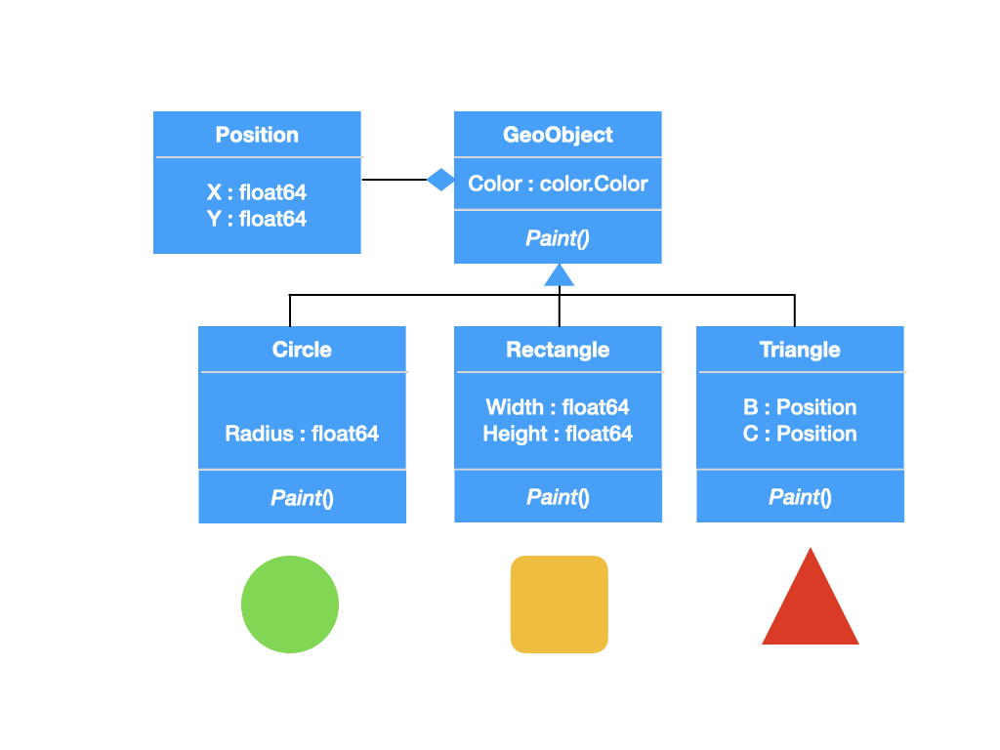

# Exercise 3 - OOP in Go

If you do not finish during the lecture period, please finish it as homework.

## Exercise 3.1  Interfaces, Polymorphism and Embedding

The image shows a typical UML design with inheritance, aggregation and polymorph methods.

Implement this design as close as possible to the design in Go:

- The `Paint()` method should print the names and values of the fields to the console
- Allocate an array of polymorph objects and call Paint() in a loop

### Part A - Yourself: Design on paper

Do this part without a coding agent and before you write any code. Answer for the UML diagram:

- What becomes a struct, what becomes embedding, what becomes an interface?
- In the UML, `GeoObject` *has* a method `Paint()`. Where does it go in Go?
- The UML shows an aggregation (diamond) between `GeoObject` and `Position`. Do you use a field or embedding? Why?
- Which type does the array need, so that the `Paint()` loop works?

### Part B - With a coding agent: Implementation

Let a coding agent implement the design and compare it with your answers from Part A. Check:

- Did the agent rebuild a class hierarchy, e.g. a `GeoObject` struct with a `Paint()` method that the shapes are supposed to "override"?
- Is the array of an interface type?
- Are the receivers consistent (value or pointer)?

### Part C - Template method

Add a method `Describe()` to `GeoObject` which prints the color and then calls `Area()` of the concrete shape.

- In Java, this is easy. Why doesn't it work this way in Go?
- Find a solution that works in Go.
- Remember the RunCounter example from the lecture. What is the connection?

### Question

- What do you have to change to add a new shape, e.g. a `Square`? And what do you have to change to add a new method, e.g. `Area()`, to all shapes?

## Exercise 3.2 Stack (Containers)

Write a generic LIFO container (stack) for all types by using `any` as dynamic type by using the OOP approach.
The stack should have at least two methods:

- Push(object)
- Pop()

Use the array append function for Push and the slices feature for Pop 

### Part A - Yourself: API and tests

- What should `Pop()` do on an empty stack: panic, return `(any, error)` or return `(any, bool)`? Decide and give a reason. Think of the error handling part of the lecture.
- Write tests for the LIFO order and for the empty stack yourself.

### Part B - The problem with any

- Push a string and pop it as an int: `s.Pop().(int)`. What happens? At compile time or at runtime?
- Let a coding agent write a generic version `Stack[T]` and compare both versions. Which errors does the compiler find now?
- Implement the `String()` method, so that `fmt.Println(stack)` prints the stack in a readable form.
